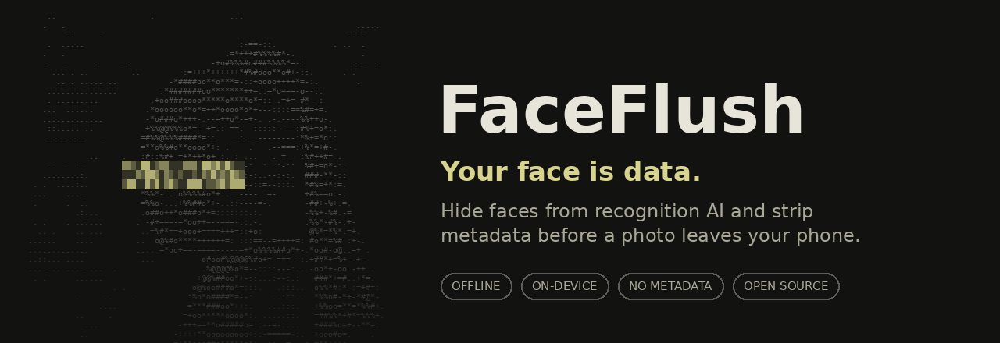
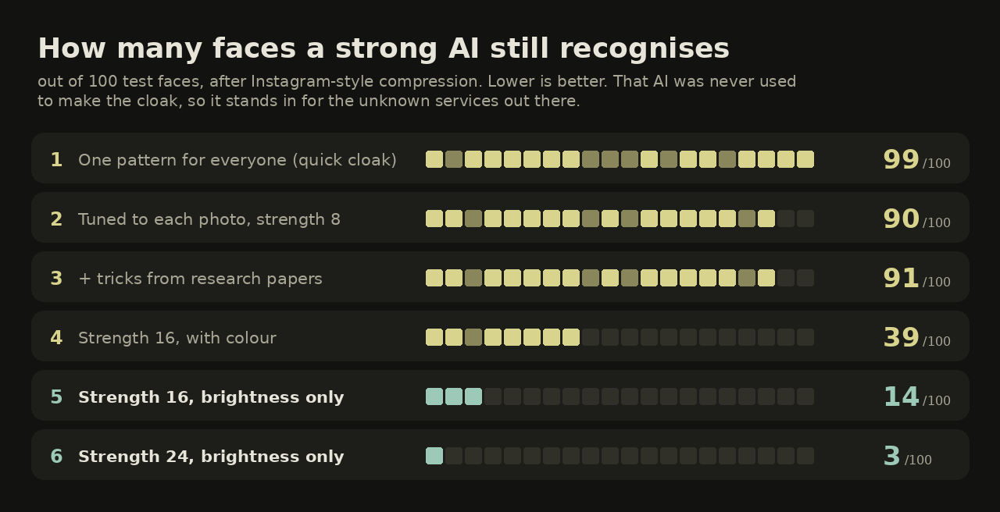
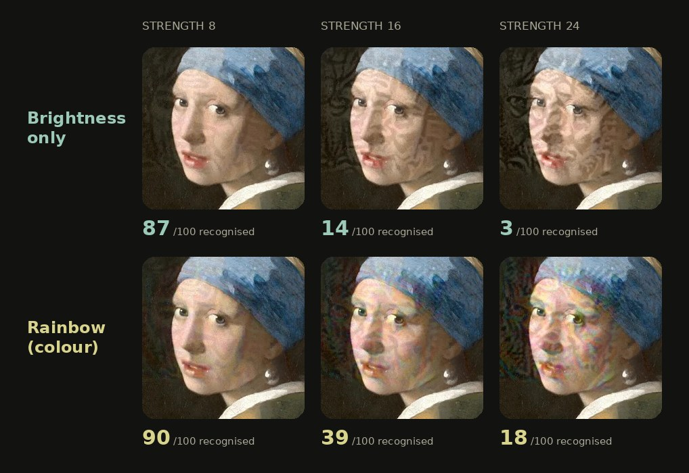

<p align="center">
  
</p>

<p align="center">
  
  
  
  
</p>

> [!WARNING]
> **Vibe-coded, not audited.** Built largely by an AI coding assistant under one person's direction.
> No protection against face recognition is guaranteed, and invisible protection is an arms race.
> For photos that really matter: Pixelate (Strong), a solid mask, or don't share it.

## What it does

| 🟫 Hide faces visibly | 🛡️ Protect invisibly | 🧹 Remove metadata only |
|---|---|---|
| Pixelate, blur, mask, dead pixels or bars over the eyes and mouth. Obvious, and the most reliable. | Tiny brightness changes, tuned to each photo **on your phone**, that make face-matching AI miss. | Strips location, camera, date, hidden thumbnails and motion-photo video. The picture stays bit-for-bit the same. |

Everything runs on the phone. The app has **no internet permission**, saved photos carry **no metadata**, and
your originals are never changed.

## What actually works

Faces still recognised by a strong AI, out of 100 test faces (lower is better, details in the [diary](docs/DIARY.md)):

| | Protection | Recognised |
|---|---|---|
| ✅ | Pixelate, Strong | **0.5** |
| ✅ | Invisible, Max privacy, strength 24 | **3** |
| 🟡 | Invisible, Max privacy, strength 16 (default) | **14** |
| ❌ | Pixelate, Light | 73 |
| ❌ | Blur, Strong | 74–82 |
| ❌ | Face shape change | 97 |
| ❌ | Invisible, quick cloak only | 99 |

## How we found the brightness trick

<p align="center">
  
</p>

1. **One pattern for everyone** is easy to apply and does almost nothing.
2. **Tuning the pattern to each photo** fools the AI it is tuned on (1 in 100), but a stronger AI it never saw
   still recognises 90. This is how earlier tools like Fawkes were beaten.
3. **Tricks from research papers** (momentum, blurred gradients) made no difference on small face crops.
4. **Turning it up to 16** helps (39), but covers the face in a rainbow shimmer.
5. A research review pointed out that **the shimmer is colour noise**. So we let the cloak change only
   brightness. Result: **14**, and **3** at strength 24.

> [!TIP]
> **Why brightness wins:** compression throws away fine colour detail first and keeps fine brightness detail.
> A colour cloak loses part of its effect every time a photo is uploaded. A brightness cloak is exactly the part
> that survives, and it even got *stronger* after compression in our tests.

**The catch:** at these strengths you can see it. Brightness only leaves smudges instead of a rainbow.
The app shows these numbers and pictures before you start, and Rainbow style is still there as a fun extra.

<p align="center">
  
</p>

<details>
<summary><b>🔬 The lab behind the numbers</b></summary>

<br>

- **Where:** a PC with an AMD RX 6600 GPU, PyTorch, scripts in [lab/](lab/).
- **Three recognition models:**
  - **SFace**: small, Apache-2.0, the one the phone carries and tunes against.
  - **ArcFace**: large and strong, *never* used to make the cloak. It stands in for the unknown services out there.
  - **FaceNet**: a third opinion.
- **150 test faces**, each checked on the original file, after JPEG, and after an Instagram-style
  downscale and recompression. Cleaning tricks (blur, median filter, WebP, colour blur) were tested too.
- **What didn't work:**
  - the face shape change (97 still recognised)
  - blurred gradients (worse)
  - per-pixel "just-noticeable difference" limits (they pushed the noise into the background)
- **On the phone:** SFace plus its gradient runs through TensorFlow Lite. 150 steps × 8 random
  transforms take about 5 minutes per face, in the background with a notification.

Every attempt, including the failures, is written up in [docs/DIARY.md](docs/DIARY.md).

</details>

<details>
<summary><b>🧭 What's next</b></summary>

<br>

- A second, licence-clean recognition model on the phone, so the cloak carries over to unknown AI even better.
- A much smaller app: the TensorFlow runtime is most of the current ~170 MB.
- A cloak that stays strong while being less visible.

Video is not planned: doing all this on every frame is a project of its own.

</details>

<details>
<summary><b>🛠️ Building</b></summary>

<br>

Requires JDK 17 and the Android SDK (platform 35).

```sh
./gradlew assembleDebug        # APKs per ABI in app/build/outputs/apk/debug/
./gradlew testDebugUnitTest    # unit tests
```

The Max privacy model (`max_cloak.tflite`, 75 MB) is not in git; build it with [lab/export_max.py](lab/export_max.py).
The README pictures come from [tools/make_readme_images.py](tools/make_readme_images.py), the app icon from
[tools/make_icon.py](tools/make_icon.py).

</details>

## Credits

- Faces are found with OpenCV's [YuNet](https://github.com/opencv/opencv_zoo/tree/main/models/face_detection_yunet)
  (MIT), or Android's built-in detector as a fallback.
- The portrait on the start screen, in the animations and in the test pictures is Johannes Vermeer's
  *Girl with a Pearl Earring* (c. 1665, public domain). The ASCII version comes from
  [tools/make_ascii_portrait.py](tools/make_ascii_portrait.py).
- Visual style inspired by [Curbox](https://github.com/nethical6/curbox).

## License

GPL-3.0-or-later, see [LICENSE](LICENSE). YuNet is MIT-licensed, see
[licenses/YuNet-MIT-LICENSE.txt](licenses/YuNet-MIT-LICENSE.txt).
