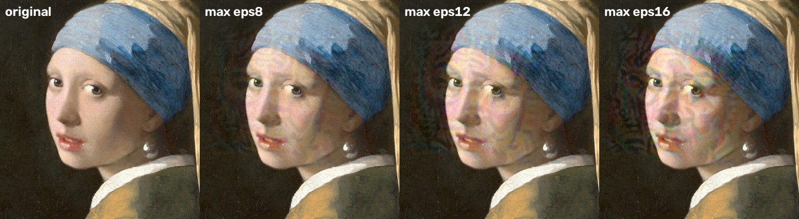
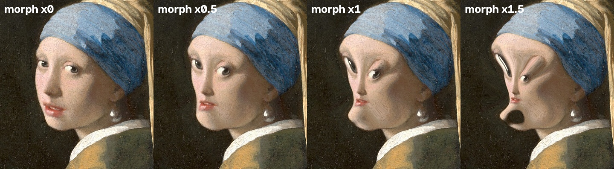
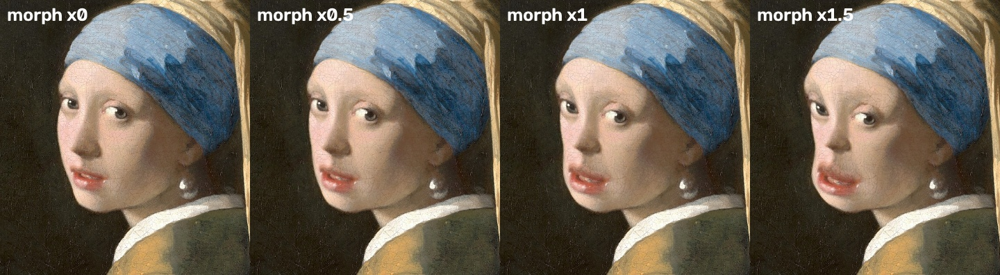
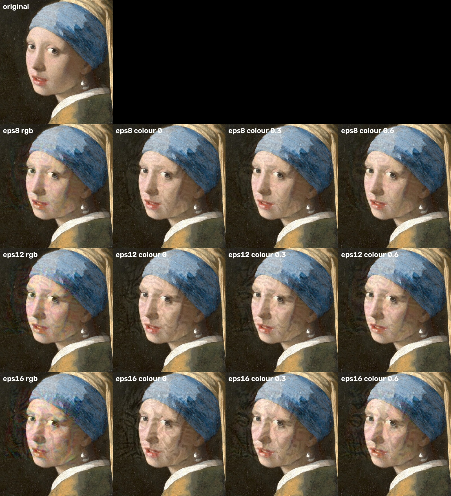
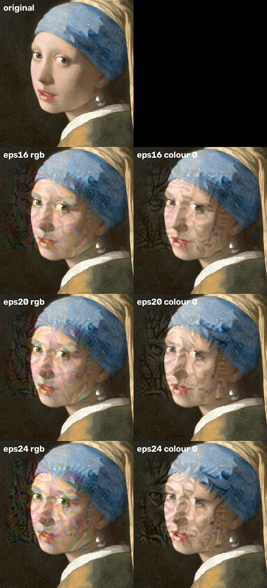
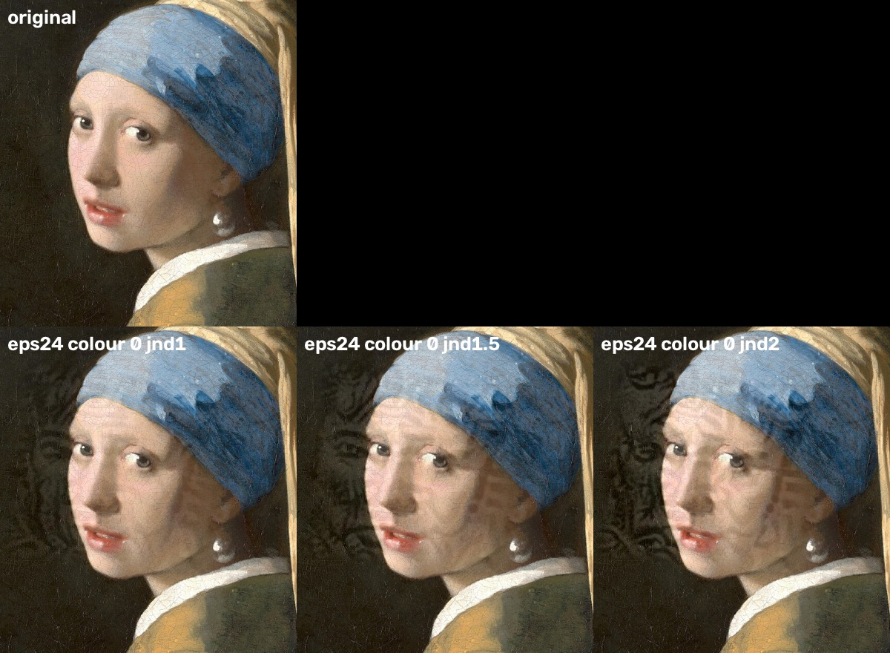

# FaceFlush development diary

A running log of what was built, tried, trained and measured, including what didn't work.
Newest entries go at the bottom. Numbers come from the lab bench described in
[lab/README.md](../lab/README.md) unless stated otherwise.

---

## 2026-10-11: Phase 1, visible protection for photos

**Goal:** an Android app that takes a photo and makes the faces in it useless to face recognition,
all on the phone and without internet access.

**Built:**
- Kotlin + Jetpack Compose app, minimum Android 10. Package `io.github.voidcast00.faceflush`, GPL-3.0.
- Face detection on the phone with OpenCV's **YuNet** model (MIT), plus Android's built-in
  detector as a lightweight fallback.
- Five techniques, each with Light / Medium / Strong presets and fine-tuning sliders: **Pixelate, Blur,
  Solid mask, Dead pixels & noise, Feature bars** (bars over the eyes, nose bridge and mouth).
- Faces can be skipped by tapping them, and you can draw extra areas by hand.
- **Privacy:**
  - no `INTERNET` permission
  - output is re-encoded from pixels, so no EXIF/GPS metadata survives
  - the original photo is never modified
- Effects are plain Kotlin on pixel arrays, so they're unit-tested on the JVM.

**Checked:** ran every technique on a sample photo, then re-ran YuNet on the result to see if it
could still find the face. Light blur, light dead pixels and light feature bars still got found;
Medium and Strong of every technique hid the face from the detector.

## 2026-10-11: UI redesign

- The preview was too big. It's now a card taking about 40% of the screen, with a fullscreen view
  (pinch to zoom). The floating "hold to compare" and "show boxes" pills became a proper toolbar.
- Visual style inspired by [Curbox](https://github.com/nethical6/curbox): near-black background,
  olive and teal accents, bold type, rounded cards.
- **Home screen background:** ASCII art generated from public-domain paintings. Ready-made ASCII
  art online has unclear copyright, so we made our own.
  - Leonardo's red-chalk self-portrait came out too faint and line-based to read as a face.
  - Vermeer's *Girl with a Pearl Earring* (lit face, dark background) works well.
  - YuNet finds her eyes and a flickering block band is drawn over them as the "disruption" mark.
  - First version misaligned the band: block glyphs come from a fallback font with a different
    width. It's now drawn on a fixed character grid with the glitch cells as squares.

## 2026-10-11: Phase 2 begins, invisible protection

**Question:** can we protect a face *without* visibly ruining the photo?

**Background, and our honest stance:**
- Recognition models turn a face into a vector ("embedding") and compare vectors.
- A small, carefully *computed* change to the pixels (an adversarial perturbation) can push that
  vector away from the person while people see almost no difference.
- This is an **arms race**. Fawkes (2020) was largely defeated by newer models within about a year.
  These techniques are a speed bump, not a guarantee, and the app has to say so.

**Decisions:**
- **F-Droid dropped** as the only target, so a real on-device ML runtime is allowed.
- Three tools:
  1. **Quick cloak:** one universal pattern trained on a PC, aligned onto each face on the phone.
     Instant.
  2. **Face morph:** a tiny trained change to face geometry. Instant.
  3. **Max privacy:** a pattern optimised for *this* photo on the phone. Minutes, runs in the
     background.
- The user chooses how visible it may be.
- Research-only models are used only on the PC, never shipped in the app.

**Lab setup:**
- Hardware: a desktop PC with an AMD RX 6600 GPU. The phone and the laptop used for app
  development are too slow for training.
- Software: PyTorch 2.9.1 on ROCm 6.4. The RX 6600 (gfx1032) needs `HSA_OVERRIDE_GFX_VERSION=10.3.0`.
- **Data:** LFW (13,233 photos, 5,749 people). 600 people are held out for testing.
- **Models:**
  - ArcFace R50 (InsightFace): strongest, research-only, used on the PC only
  - FaceNet (MIT)
  - SFace (Apache-2.0): never used for training, so it measures how well a cloak carries over to
    an unseen model
- **The bench:**
  1. protect one photo of each test person
  2. optionally recompress it like a social network (JPEG, or a 75% downscale + JPEG)
  3. re-detect and re-align the face from scratch
  4. check whether it still matches that person's *other* clean photos at a 0.1% false-match
     threshold

**Baseline results** (match rate, lower = better protected):

| what was applied | ArcFace | SFace | FaceNet |
|---|---|---|---|
| nothing | 99% | 98% | 96% |
| faint random noise (σ8) | 99% | 98% | 96% |
| strong random noise (σ20, clearly visible) | 97% | 93% | 91% |
| light blur | 99% | 95% | 89% |
| strong blur | **74–82%** | 13–15% | 1–2% |
| pixelate, 16 blocks | 40% → **73% after social recompression** | 4–21% | 3–6% |
| pixelate, 6 blocks | 0.5% | 0.3% | 0.5% |

**Lessons:**
- Random noise does nothing. Invisible protection has to be *trained* against the models.
- The strongest model sees through heavy blur, and through light pixelation once the photo is
  downscaled (downscaling smooths the blocks back out).
- Only strong pixelation or a solid mask are near-certain. The app's blur description overpromised
  and needs correcting.

**Quick cloak training (in progress):**
- One 3×112×112 pattern in canonical face space, strength ε=10/255.
- Trained against ArcFace + FaceNet over 9,448 faces.
- Random transforms during training: alignment jitter, downscaling, blur, noise, exposure.
- Weaker on smooth skin, stronger on textured areas, to stay less visible.
- The average similarity of a cloaked face to its clean self drops from 0.94 to about 0.65, then
  plateaus. That's typical of a single universal pattern, and is why Max mode exists.

**Max privacy engine:**
- The models and their gradient were exported to one TensorFlow Lite file the phone can run
  (`lab/export_max.py`). It needs TFLite's "select TF ops", so it can't be pure LiteRT builtins.
- The TFLite gradient matches TensorFlow's (cosine 0.9966 with float16 weights, 0.9999991 with
  float32).
- **Problems hit:**
  - onnx2tf's own test-image download broke with current NumPy; we patched in synthetic images
    instead.
  - The antialiased resize (`ScaleAndTranslate`) has no TFLite kernel; replaced with a plain
    bilinear resize.
  - The file was 258 MB: two signatures stored the weights twice. Merged into one signature,
    129 MB.
  - Float16 weights didn't shrink it, because the gradient ops need float32.
  - FaceNet alone is 89 MB. Next: test whether attacking SFace alone carries over to ArcFace
    well enough to drop FaceNet.
- The phone-side optimisation loop (`MaxCloak.kt`) is written and unit-tested with a fake model.

## 2026-10-11: Quick cloak results

Trained for 4,000 steps (about 32 min on the RX 6600). The similarity to the clean face plateaued
around 0.65 after 1,000 steps. Bench, match rate (lower = better), "social" = after a 75% downscale
+ JPEG 80:

| cloak strength | PSNR | ArcFace (trained against) | SFace (held out) | FaceNet (trained against) |
|---|---|---|---|---|
| none | — | 99% | 98% | 96% |
| ε4 | 44.9 dB | 99% | 98% | 94% |
| ε8 | 38.9 dB | 99% | 95% | 77% |
| ε12 | 35.4 dB | 94% | 80% | 43% |
| ε16 | 32.9 dB | 78% | 58% | 18% |

Recompression barely changes the numbers (e.g. ε16 ArcFace 78.8% → 78.0% after "social"), so the
robustness training worked.

**Verdict:** a single universal pattern is too weak against a strong model. ArcFace still matches
78% of faces at the most visible strength, even though it was one of the models the pattern was
trained against. It's a light extra layer, not protection on its own. Per-photo optimisation
(Max privacy) is where real invisible protection has to come from. Next: simulate it.

## 2026-10-11: Max privacy simulation

Simulated the phone's per-photo optimisation on the PC: start from the quick cloak, then 150
signed-gradient steps, each averaged over 8 random transforms, at ε8 (PSNR about 39.5 dB, hard to
see). ArcFace is **never** attacked: the phone can't ship it, so it stands in for "a strong model
we don't have". 150 test photos; match rate, lower = better:

| models attacked on the phone | ArcFace (never seen) | SFace | FaceNet | time per photo (RX 6600) |
|---|---|---|---|---|
| nothing (clean photo) | 99% | 98% | 96% | — |
| SFace only | 85% (90% social) | **1%** (1% social) | 42% (51% social) | 6.8 s |
| SFace + FaceNet | 85% (89% social) | **3%** (13% social) | **1%** (1% social) | 10.6 s |

**What this means:**
- Against the models it optimises against, per-photo cloaking works almost perfectly and survives
  recompression.
- It barely carries over to a strong model it has never seen (ArcFace 99% → 85%). This is the
  core weakness of every invisible cloak, and it is exactly how Fawkes was beaten.
- Adding FaceNet beats FaceNet too, but does **nothing** extra against ArcFace. So FaceNet (89 MB,
  about 50% slower) is not worth shipping: the phone engine will be SFace only.
- Still better than the quick cloak, which at ε8 left ArcFace at 99%.

Next: try a higher visibility (ε16) to see whether transfer improves, and look at
transfer-boosting tricks (momentum, input diversity) before building the phone side.

## 2026-10-11: App fixes

- Blur and Pixelate descriptions rewritten to match the lab: blur fools weaker AI, but a strong
  model still matched about 3 in 4 heavily blurred faces.
- The quick-cloak pattern now ships in the app (`assets/cloak_pattern.bin`, 147 KB).
- Fullscreen preview: on some phones the dialog's bottom edge sat under the navigation bar, so the
  compare and boxes buttons couldn't be reached. They moved into a top bar next to the close button.

## 2026-10-11: Max privacy at higher visibility, and a broken morph

**Max privacy at ε16** (SFace only, same setup as above):

| | ArcFace (never seen) | SFace (attacked) | FaceNet (never seen) | PSNR |
|---|---|---|---|---|
| ε8 | 85% (90% social) | 1% | 42% | 39.5 dB |
| ε16 | **31%** (39% social) | 0% | **2%** | 34.4 dB |

Doubling the strength makes the cloak carry over to models it never saw far better: ArcFace drops
from 85% to 31%, and FaceNet to 2% without ever being attacked. The price is visibility: a pastel
colour shimmer over the face and the background around it. ε8 is faint at phone size; ε16 is
obvious when you look for it. Rendered on Vermeer's *Girl with a Pearl Earring* (public domain)
with `lab/demo_max.py`:

**Face morph, first attempt: failed.** Training "worked" (similarity to the clean face fell to
0.30), but rendering it showed why:

Each of the 12 control points was limited to 3 px, but Gaussian RBF interpolation between close
points (eyes, brows, mouth corners) overshoots, so skin between them moved up to 14 px. The
optimiser happily used that. Fix: cap the displacement of *every pixel* (`morph.limit`), not just
the control points. Retraining. (The bench at the end of the run also crashed on float64 maps
passed to `cv2.remap`; fixed.)

## 2026-10-11: Max privacy on the phone

- The engine is now SFace only: `max_cloak.tflite`, 75 MB (was 129 MB with FaceNet). Its gradient
  matches TensorFlow's (cosine 0.999999).
- Runs on a mid-range Android phone through TFLite 2.16.1 with the Flex delegate (72 of 445 ops need
  TensorFlow kernels). One model call takes about 0.25 s, so a face (150 steps × 8 transforms,
  same as the PC simulation) takes about 5 minutes.
- Runs as a WorkManager foreground job with a progress notification and a Cancel button; the
  result comes back into the editor even if the app was closed in between.
- An explainer sheet with the measured numbers appears the first time Invisible is picked, and
  before every Max run the user has to tick "I understand this is not a guarantee".
- Permissions added: notifications and a data-sync foreground service. WorkManager also tried to add
  network-state and boot permissions; both are removed. Still no internet access.
- **Size problem:** the TensorFlow Flex runtime is 68 MB and the model 75 MB, so the arm64 APK is
  about 170 MB in release. A custom Flex build with only the 72 ops used should shrink the runtime
  a lot.
- The model file isn't in git (75 MB); build it with `lab/export_max.py`.

## 2026-10-11: Face morph, second attempt: works on paper, not worth it

Retrained with every pixel capped at 3 canonical px (about 8% of the eye distance). Similarity to
the clean face plateaued at 0.64, about the same as the quick cloak. Bench (match rate, lower =
better):

| morph amount | PSNR | ArcFace (trained against) | SFace (held out) | FaceNet (trained against) |
|---|---|---|---|---|
| ×0.5 | 34.6 dB | 99% | 97% | 92% |
| ×1 | 29.7 dB | 97% | 95% | 70% |
| ×1.5 | 27.3 dB | 88% | 85% | 40% |

**Verdict:** the morph is the worst trade we've measured. It visibly changes the face (fuller mouth,
shifted eyes) while ArcFace still recognises 97% at ×1. Strong recognition models are trained to be
robust to exactly this kind of variation (expressions, angles, lens distortion). Max privacy at ε16
does far more for a comparable visual cost.

**Decision:** the morph stays in the app but is clearly marked as practically useless: off by
default, its slider is labelled "barely works", and the explainer quotes the numbers above. The
Strong preset of the cloak now uses ε16, the strength measured in the lab.

## 2026-10-11: No video

Video support is dropped from the plan. Processing every frame (and keeping faces tracked between
frames) would be a project of its own; the effort goes into making photo protection better instead.
The disabled "Choose a video (coming soon)" button is gone from the home screen.

## 2026-10-12: Literature review and the first transfer tricks

A literature review (via a Perplexity deep search) suggested several ways to make Max privacy carry
over better to models the phone never sees, and to get rid of the rainbow shimmer:

- **Several different models** instead of SFace alone: the strongest lever in published work.
- **Momentum (MI-FGSM)** and **translation-invariant gradients (TI)**: cheap optimiser tricks.
- **Real JPEG during optimisation** (differentiable JPEG with 4:2:0 colour subsampling, e.g. Kornia
  or NECLA Diff-JPEG).
- **Colour vs brightness:** the shimmer means the optimiser spends much of its budget on colour,
  which JPEG throws away first and which is easy to "clean" with a colour blur.
- Honesty points: services that retrain against a public cloak defeated Fawkes and LowKey (down to
  about 3% protection); fixed, universal patterns are easy to detect; no paper has tested against
  PimEyes itself.
- EdgeFace (BSD-3 code) looked like a good second model, but its weights were trained on WebFace
  data that is non-commercial only, so it can't ship in a GPL app without the authors' confirmation.
  Lab use only for now.

`sim_max.py` now has `--momentum`, `--ti` (gradient blur) and `--chroma` (colour share of the
budget, 0 = brightness only), and `--clean` runs a set of cleaning tricks (JPEG 50, WebP, colour
halving, colour blur, blur, median, half size) plus an unprotected reference under each.

**Results** (SFace attacked, ArcFace held out, ε8, 150 probes, match rate, lower = better):

| variant | ArcFace | ArcFace after social | SFace | FaceNet | colour / brightness change |
|---|---|---|---|---|---|
| before (RGB) | 84.7% | 90.0% | 0.7% | 42% | 3.0 / 3.7 |
| momentum 0.9 | 85.3% | 91.3% | 0.7% | 43% | 3.0 / 3.7 |
| TI blur σ2 | 95.3% | 96.0% | – | 63% | 3.5 / 3.6 |
| momentum + TI | 96.0% | 95.3% | – | 65% | 3.5 / 3.7 |
| **brightness only** | 88.7% | **87.3%** | 2.7% | – | **0.0** / 4.8 |

- **Momentum** changes nothing with a single model; it should matter more once there are several.
- **TI makes it worse.** It was designed for large photos of everyday objects; on 112 px faces even
  σ2 smooths away the fine detail that does the work.
- **Brightness only is the surprise:** no colour change at all (so no rainbow shimmer possible),
  slightly weaker on the original file, slightly *better* after social-media compression, and
  the same overall PSNR.

**Colour sweep** (same setup; colour = share of the budget colour may use):

| colour share | ArcFace | ArcFace after social | SFace | colour / brightness change |
|---|---|---|---|---|
| 0 (brightness only) | 88.7% | 87.3% | 2.7% | 0.0 / 4.8 |
| 0.3 | 89.3% | 88.7% | 3.3% | 0.75 / 4.4 |
| 0.6 | 88.7% | 89.3% | 0.7% | 1.3 / 4.1 |
| 1.0 | 86.0% | 90.0% | 0.7% | 2.0 / 3.8 |
| unlimited RGB (before) | 84.7% | 90.0% | 0.7% | 3.0 / 3.7 |

Colour buys nothing that survives compression: all variants are within a few points after social.
It only changes what the noise looks like:

Unlimited colour gives the pastel rainbow shimmer. Brightness only has no rainbow, but leaves faint
grey hatching on smooth skin and dark swirls in the background (barely visible at ε8, clear at ε16).
**Decision:** brightness only becomes the default; the next step is to move that remaining change
away from smooth skin (see JND below).

**Cleaning tests** (today's RGB cloak, ε8; match rate against SFace, the attacked model):

| cleaning | none | colour halving | colour blur | blur | median | half size | JPEG 50 | WebP 75 |
|---|---|---|---|---|---|---|---|---|
| SFace | 0.7% | 0.7% | 2.0% | 2.0% | 0.7% | 1.3% | 2.7% | 5.3% |

None of these hurt unprotected photos (97–99% still match), so a service could afford any of them,
and the cloak survives all of them. ArcFace stays at 82–93% whatever is done, because it was never
fooled much in the first place: transfer, not robustness, is the weak point.

## 2026-10-12: Which models may ship, and the HyperFace idea

A second review looked for face recognition models whose weights may legally go into a GPL app:

- **No small, accurate, licence-clean model exists.** Small models (MobileFaceNet variants, EdgeFace,
  Qualcomm's) were trained on MS1M, WebFace or similar collections that are non-commercial. Most
  synthetic face datasets are non-commercial too, directly (DigiFace-1M, FaceSynthetics) or through
  the generator they were made with (SynFace, DCFace, IDiff-Face, GANDiffFace).
- **SFace** (the model the app ships): the weights are explicitly Apache-2.0, which is fine for GPL,
  but OpenCV does not say which photos it was trained on. A `MODEL-LICENSES.md` should state exactly
  that, without guessing.
- **HyperFace** (Idiap) is the one clean candidate: MIT-licensed weights, trained only on synthetic
  identities (dataset CC BY-SA 4.0). But the released model is an IResNet-50: a 390 MB checkpoint
  (about 175 MB as a plain model, 87 MB at half precision) and roughly 25× the compute of SFace. On
  the phone that would turn about 5 minutes per face into one to two hours, so size is not the real
  problem, speed is.
- **JND masks** (just-noticeable difference): a cheap classic formula for how much brightness change
  the eye misses at each pixel (more in very dark or bright areas and texture, less on smooth skin).
  No one has tested it on face cloaks, so it is our own experiment next.

**The HyperFace idea, step by step:**

1. **Free test first:** run Max privacy in the lab with SFace + HyperFace together (the PC does not
   care about speed) and see whether ArcFace's match rate drops. If it barely moves, a second model
   is not worth the effort.
2. **If it helps:** train a small model (MobileFaceNet size) to copy HyperFace's answers on the
   HyperFace dataset ("distillation"). Estimated at a few hours on a rented A100 (roughly $5–20) or
   one to two days on the lab PC.
3. Ship that small model next to SFace, with its origin documented. CC BY-SA "share-alike" likely
   carries over to the trained weights, which is compatible with GPL-3.0 but needs proper credit.

## 2026-10-12: Stronger settings, brightness only vs. colour

The same per-photo simulation (SFace attacked, ArcFace held out, 150 photos, 150 steps × 8
transforms), now at higher visibility limits. Match rate of ArcFace, the model the cloak never saw
(lower is better), on the original file and after the social-media simulation:

| strength | with colour | with colour, after social | brightness only | brightness only, after social | PSNR |
|---|---|---|---|---|---|
| ε8 | 84.7% | 90.0% | 88.7% | 87.3% | 39.5 |
| ε16 | 30.7% | 39.3% | **24.0%** | **14.0%** | 34.4 |
| ε20 | 26.7% | 29.3% | **9.3%** | **4.0%** | 32.8 |
| ε24 | 15.3% | 18.0% | **5.3%** | **3.3%** | 31.6 |

SFace and FaceNet stay at 0–1.3% for every brightness-only run from ε16 up.

- **From ε16 up, brightness only is far stronger than colour**, with the same PSNR. At ε8 the two
  were level; at ε20 brightness only lets through a third as many matches.
- **Compression helps it instead of hurting it.** With colour, JPEG and the social-media chain
  undo part of the protection (30.7% → 39.3% at ε16). Brightness only gets *better* after them
  (24.0% → 14.0%). JPEG keeps brightness detail and throws colour detail away, so a brightness
  pattern is what is left after upload anyway.
- This is the first setting that gets ArcFace below 10% after social-media compression.

The catch is visibility. None of these strengths are invisible:

With colour, the face is covered in pastel rainbow blotches. Brightness only has no rainbow, but
leaves brownish, maze-like smudges on the cheeks and forehead (like dirt or face paint) and dark
swirls in the background. At ε16 it already reads as "something was done to this photo", and at
ε24 it is obvious. So these are "visible protection" settings: fine for someone who cares more about
privacy than looks, not for a photo that should look untouched.

**Decision:** brightness only replaces colour for Max privacy at every strength. The next test (JND
limits, running now) tries to keep the strength of ε16–24 while moving the change off smooth skin,
where it shows most, into edges, texture and dark areas, where the eye misses it.

## 2026-10-12: JND limits (first try: no gain)

The idea: instead of one limit for every pixel, let each pixel change only by a set number of
"just-noticeable differences" (JND), computed from the clean photo with a classic formula. Smooth
mid-tone skin gets little room (about 4 levels), dark areas, edges and texture get more. Brightness
only, with ε24 as the overall cap. Match rates (lower is better), next to plain brightness only:

| setting | ArcFace | ArcFace after social | SFace | FaceNet | brightness change | PSNR |
|---|---|---|---|---|---|---|
| JND 1× | 94.0% | 95.3% | 13.3% | 60.7% | 4.6 | 39.7 |
| JND 1.5× | 78.0% | 76.7% | 0.7% | 16.7% | 6.5 | 36.5 |
| JND 2× | 41.3% | 37.3% | 0.7% | 3.3% | 8.0 | 34.6 |
| plain brightness only, ε16 (for comparison) | 24.0% | 14.0% | 0.7% | 1.3% | 8.5 | 34.3 |

- **Less protection for the same amount of change.** JND 2× changes the photo as much as plain
  ε16, yet lets through more than twice as many ArcFace matches (37% vs. 14% after social).
- **The change moved, but to the wrong place.** The formula allows far more change in dark areas
  (up to about 20 levels in near-black), so the optimiser pours its effort into the dark background
  and draws ghostly eye-like shapes and swirls there, which are easy to spot. Skin is cleaner at 1×,
  but at 1× the cloak barely works.
- The classic formula was made for video coding on old displays; its generous allowance for dark
  areas does not match how a phone screen shows a dark background.

**Decision:** the JND limit as built is not a win; plain brightness only stays the best trade-off.
A possible second try: keep only the texture/edge part of the formula, cap dark areas at the
mid-tone allowance, and fade the pattern out over the background next to the face.
